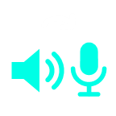

<p align="center">
  
</p>

<h1 align="center">SoundHop</h1>

<p align="center">
  Pule entre seus dispositivos de áudio com um toque no Ulanzi Deck.<br>
  <em>Hop between your audio devices with one key press on the Ulanzi Deck.</em>
</p>

---

Plugin para o **Ulanzi Studio** (Windows) que alterna o dispositivo de áudio padrão a cada toque na tecla:

- **Alternar Saída** — alto-falantes, fones, headsets…
- **Alternar Entrada** — microfones.

Cada troca define o dispositivo como **Dispositivo Padrão** *e* **Dispositivo de Comunicação Padrão**, então Discord, Teams e afins acompanham a troca.

## Recursos

- Alternar entre **todos** os dispositivos ativos ou só entre os **selecionados**.
- O nome do dispositivo atual aparece na tecla (nome curto, nome completo, tipo ou nenhum).
- A tecla se atualiza sozinha se o dispositivo for trocado fora do plugin.
- Dispositivos desconectados continuam salvos na seleção e voltam ao ciclo quando reconectados.
- Sem executáveis de terceiros: usa as APIs de áudio do próprio Windows (`IMMDeviceEnumerator` / `IPolicyConfig`) por meio de um helper PowerShell + C#.
- Interface em português e inglês.

## Instalação

1. Baixe o `SoundHop-x.y.z.zip` em [Releases](../../releases).
2. Extraia a pasta `com.ulanzi.soundhop.ulanziPlugin` em `%APPDATA%\Ulanzi\UlanziDeck\Plugins\`.
3. Reinicie o Ulanzi Studio. As ações aparecem na categoria **SoundHop**.

### A partir do código-fonte

```bash
cd com.ulanzi.soundhop.ulanziPlugin
npm install --omit=dev
```

Copie a pasta (com `node_modules`) para o diretório de plugins acima. Para gerar o zip de release:

```bash
powershell -ExecutionPolicy Bypass -File tools/pack.ps1
```

## Requisitos

- Windows 10 ou 11
- Ulanzi Studio 2.1.4+ (testado com Ulanzi Studio 3)

## Desenvolvimento

```bash
cd com.ulanzi.soundhop.ulanziPlugin
node plugin/audio/cli.js              # lista dispositivos (* = padrão, C = comunicação)
node plugin/audio/cli.js next output  # troca para a próxima saída
node plugin/audio/cli.js next input   # troca para a próxima entrada
```

Com o [UlanziDeck Simulator](https://github.com/UlanziTechnology/UlanziDeckPlugin-SDK), inicie o serviço apontando para a porta do simulador. Sem argumentos ele conecta na porta 3906, que é a do Ulanzi Studio real:

```bash
node plugin/app.js 127.0.0.1 39069 pt_PT
```

### Estrutura

```
com.ulanzi.soundhop.ulanziPlugin/
├── manifest.json
├── plugin/
│   ├── app.js              # serviço principal (Node)
│   ├── keyImage.js         # desenha ícone + nome do dispositivo na tecla
│   ├── audio/
│   │   ├── AudioEndpoints.cs   # Core Audio via COM
│   │   ├── audio-host.ps1      # processo PowerShell persistente
│   │   ├── AudioService.js     # ponte Node ↔ PowerShell
│   │   └── cycle.js            # lógica de rotação
│   └── ulanzi-api/         # SDK Node da Ulanzi
├── property-inspector/     # tela de configuração
└── libs/                   # SDK HTML da Ulanzi
```

## Licença

[Apache 2.0](LICENSE). Inclui as bibliotecas do [UlanziDeck Plugin SDK](https://github.com/UlanziTechnology/UlanziDeckPlugin-SDK) (Apache 2.0).
